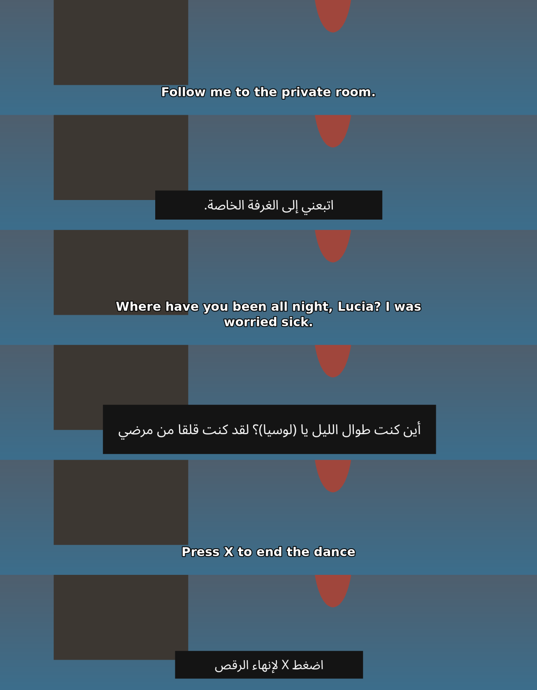

# Live English -> Arabic translation of on-screen text (experimental)

Off by default. Switch on in the app's Settings tab ("ترجمة النصوص للعربي (تجريبي)" / "Translate on-screen text to Arabic
(experimental)") or, for the command line, `TRANSLATE_AR=1` (and `TRANSLATE_DIR=<pack folder>`). The first time it is switched on the
app downloads the translation pack (about 96 MB, sha256-pinned, `release.TRANSLATE_FILES`); it is not in the installer.



*Made by `tools/translate_demo.py` with the real models: the English subtitle on a made-up game frame, and the same frame with the
Arabic box. The CI job `translate` produces the same picture on every run (artifact `translate-report-*`).*

## What viewers get

* The Arabic box sits exactly over the English subtitle: it is sized from the OCR bounding box of the English text plus padding, fully
  **opaque** (near black, like the dark outline game subtitles are drawn with), so no English letter shows through or around it. If the
  Arabic is longer it grows wider (up to 92 % of the frame, same centre) and then taller (upwards, anchored at the English line's bottom
  edge), never narrower or shorter than the English it hides.
* The Arabic is on **the same frames the English is on**: the frame is read when it is captured, the finished box is drawn when that frame
  is shown (it waits `delay` seconds in memory anyway). It stays while the same English line stays and goes when the line goes
  (frame-exact in the tests, below).
* It goes to the **stream / output only**. StreamSafe never touches the streamer's own game view or OBS preview: the Arabic exists
  only in the frames StreamSafe sends to its output.

## Safety contract (what must never change)

| Rule | How it is kept | Test |
|---|---|---|
| Off by default | `translate_ar=False` in `Config` and in the app settings; the engine only reads `TRANSLATE_AR` when the app sets it | `test_off_by_default_everywhere` |
| Own worker, bounded queue | a **separate process** (a crash, even a segfault inside a model library, ends only the worker); jobs wait in a queue of 2, a full queue drops the read; the worker always takes the newest read | `test_queue_is_bounded...`, `..._dying_factory` |
| Slow, crashing, erroring or never-loading worker = stream exactly as without it | the frame loop only copies a small crop into the queue and blends a finished picture; it never waits for the worker; a read that is not finished when its frame is shown is not used; every call into the service is wrapped so it cannot raise | `test_realtime_a_failing_slow_or_dead_worker_leaves_the_stream_exactly_as_without_it` (4 variants: every output frame byte-identical to the run without translation, 0 dropped, 0 late) |
| Cover / slate / mute / analysis untouched | no change to `gate.py`, `analysis/`, `render/`; the overlay is a separate step after `gate.render` | diff of this branch |
| Never drawn on a full-scene cover or slate (and not on a held frame) | the overlay is only applied when `out is frame`, i.e. the gate composed this very frame normally; `out` being the slate, the scene card or a repeated earlier frame skips it | `test_realtime_arabic_is_never_drawn_on_a_slate_or_scene_card` |
| Nothing the gate keeps carries Arabic | the overlay is drawn on a **copy**; the gate's own frame (which it may repeat on a held frame) is untouched | `test_overlay_is_a_copy...` |
| Same-frame timing | the signature of each frame's text region is taken at capture; a finished read applies to every frame whose region looks like the read's, before or after it in time | `test_service_matches_reads_to_frames...`, `test_realtime_arabic_is_on_exactly_the_frames_of_the_english_and_hides_it` |
| Light | see "Cost" | `test_real_realtime_run_and_its_cost` |

## How it works

1. **Frame loop** (`translate/service.py`). For every captured frame: a 256x32 bright-pixel signature of the text region(s), about
   0.1 ms. A read is handed to the worker when the region shows *new or changed text* (signature differs from the last read's) or when
   unchanged text is due for another look (every `translate_refresh_s`, 2 s), never closer than `translate_min_gap_s` (0.25 s) to the
   previous read, and not at all while nothing is written there. Unchanged text costs nothing.
2. **Worker** (`translate/pipeline.py`, own process). Text reader (`ocr.py`): PP-OCR detector finds the text boxes inside the region,
   the English recogniser reads each; low-confidence and non-English lines are dropped (`textproc.py`); lines of one subtitle become
   one paragraph; its English is the cache key (case, spacing and punctuation normalised; 512 entries, so a repeated line is never
   translated twice; a read whose English equals the last read is not translated or drawn again); the paragraph is split into
   sentences (the model drops words from long inputs) and translated by opus-mt-en-ar on CTranslate2 (int8, CPU, beam 2,
   no-repeat-3-gram); the Arabic box is rendered (`arabic.py`).
3. **Frame loop, output side.** After `gate.render`: look up the finished boxes whose read looked like this frame, copy the frame,
   blend the opaque boxes, send that copy to the sink. No match = the very same frame object, untouched.

Regions: the subtitle band (bottom 20 %, middle 84 %). `TRANSLATE_REGIONS=subtitles,help` adds the top-left help box of GTA V
(prompts such as "Press X to ..."). The regions are GTA V's; GTA 6 positions are one table (`service.REGIONS`).

### Arabic rendering

`arabic-reshaper` (MIT) shapes the letters (initial / medial / final forms, lam-alef ligatures); a ~60-line bidi pass in
`arabic.py` puts the right-to-left text in drawing order with Latin words, button names ("X") and numbers staying left-to-right and
brackets mirrored. (`python-bidi` is LGPL and Pillow's own bidi needs libraries the Windows wheels do not carry, so neither is used.)
Text is drawn with Pillow's BASIC layout engine: the same pixels on every platform. Fonts: Noto Sans Arabic for Arabic and Noto Sans
for Latin (the Arabic font has no Latin letters), both in the pack (OFL). The result was checked by eye (`images/translate_sample.png`)
and the ordering by tests.

## Licences (checked 14 Nov 2026; recorded in `NOTICE.md`, `installer/licenses/NOTICE.txt` and `NOTICE-translate.txt` inside the pack)

| Part | What | Licence | Commercial use + redistribution |
|---|---|---|---|
| Translator | Helsinki-NLP/opus-mt-en-ar, revision `0308798`, converted to CTranslate2 int8 | **CC-BY 4.0** per the OPUS-MT project ("pre-trained downloadable translation models, CC-BY 4.0", github.com/Helsinki-NLP/Opus-MT); the **Hugging Face model card says Apache-2.0** | yes, with attribution (below); both texts are shipped. Not NLLB / M2M (non-commercial) |
| OCR | PaddleOCR PP-OCRv4 detector + PP-OCRv3 English recogniser, ONNX conversions by RapidOCR (huggingface.co/SWHL/RapidOCR, pinned commit) | Apache-2.0 | yes |
| Fonts | Noto Sans Arabic, Noto Sans | SIL OFL 1.1 | yes (not sold on their own; unmodified) |
| Libraries | CTranslate2 (MIT), SentencePiece (Apache-2.0), arabic-reshaper (MIT), ONNX Runtime (MIT), Pillow (HPND), OpenCV (Apache-2.0) | permissive | yes |

Attribution to show wherever the app lists its credits: *"Translation by OPUS-MT (Helsinki-NLP), https://github.com/Helsinki-NLP/Opus-MT,
CC-BY 4.0."* The weights were converted and quantized: the notice says so (CC-BY asks to indicate changes).

**Open point for the owner (legal judgement, not made here).** The OPUS-MT / Tatoeba-Challenge README says the Tatoeba *training
data* is CC-BY-NC-SA 4.0 (test sets CC-BY 2.0 FR). The authors still release the *models* as CC-BY 4.0 / Apache-2.0, and we follow
what they declare; whether the non-commercial data licence could reach the weights is a question we did not try to settle. If the
answer is "yes, it does", the translator is one swappable file set (`translator.py`, `tools/build_translate_pack.py`).

## Cost

Measured by `tests/test_translate_real.py::test_real_realtime_run_and_its_cost` (the engine on its clock with the stub analyzer, 26 s
of 720p video with a subtitle changing every 3 s, real models; "added" = CPU seconds of the process and its children with translation
minus without, per second of video). Everything runs on the **CPU** (2 threads that sleep when idle): the GPU is left to the
protection, so this works the same on NVIDIA, AMD and Intel (the OCR's DirectML provider is deliberately not used: the models are
tiny and a second GPU client would compete with the protection models).

| Measured on a 2-core Linux sandbox (Python 3.13), 720p | value |
|---|---|
| Added CPU (whole run incl. one-time model load and process start) | **137 ms of CPU per second of video** (about 14 % of one core) |
| Reads of the screen | 16 in 26 s (0.62 per second; text changed 9 times; unchanged text is not re-read) |
| Worker per read: text reader / translation (cached lines: 0) / box rendering | 126 ms / 58 ms / 9 ms mean (p95 160 / 115 / 23 ms), a read is 0.15-0.3 s of 2 threads |
| Arabic on the English's frames | 600 of 600, on no other frame (frame-exact) |
| GPU | none used (CPU only) |

The Linux and Windows CI numbers (same test, `translate` workflow, artifacts `translate-report-Linux` / `translate-report-Windows`,
`cost.json`) are in the final report; they replace these when they differ.

Frame loop (the threads that must stay on time): signature about 0.5 ms mean per captured frame; overlay lookup + copy + blend
about 0.2 ms mean, 1.5 ms p95 on a frame with Arabic (a 720p copy; ~3 ms at 1080p); nothing on frames without. The stream's lateness did not change in the tests
(0 late frames, max lateness unchanged).

## Limits (also in `docs/beta/KNOWN_LIMITS.md`, item 18)

* **Translation quality is modest** (opus-mt-en-ar: BLEU 14 on Tatoeba). It can drop or garble words, names and slang
  ("I was worried sick" came out as "I was worried from my illness"). It is a help for understanding, not a subtitle track.
* Reads **white / light game subtitles with an outline** on the subtitle band (and the help box with `TRANSLATE_REGIONS`); other text
  (signs, phones, HUD numbers), dark or coloured subtitles and unusual fonts are not read. Only English source text.
* A subtitle that fades in is read when it first changes, then again when it settles: for a few frames the box can lag. Reads happen
  at most every 0.25 s, so a very fast change can show the English for a couple of frames.
* The models load in the background after the stream starts (a few seconds): no Arabic until they are ready.
* Not drawn on a slate, a scene card or a repeated (held) frame, by design.
* Offline mode (`MODE=offline`) does not translate (benchmarks only).
* Windows installer build with the new libraries (`ctranslate2`, `sentencepiece`, `arabic_reshaper`) is configured in
  `tools/streamsafe.spec` but not yet built; the Windows CI runs the real-model tests from source.
* The pack must be uploaded to `release.TRANSLATE_BASE_URL` (CI artifact `translate-pack`) for the in-app download to work; the table
  in `release.py` pins the exact files built on 14 Nov 2026 (the converted `model.bin` is not byte-for-byte reproducible across
  converter versions, so the table pins the uploaded copy).

## Build, test, upload

```
python tools/build_translate_pack.py OUT        # needs torch + transformers once; prints the table for release.py
python tools/translate_demo.py OUT sample.png   # before / after picture with the real models
STREAMSAFE_TRANSLATE_PACK=OUT python -m pytest -q tests/test_translate_real.py -s
python -m pytest -q tests/test_translate.py     # stub tests, no models needed
```
